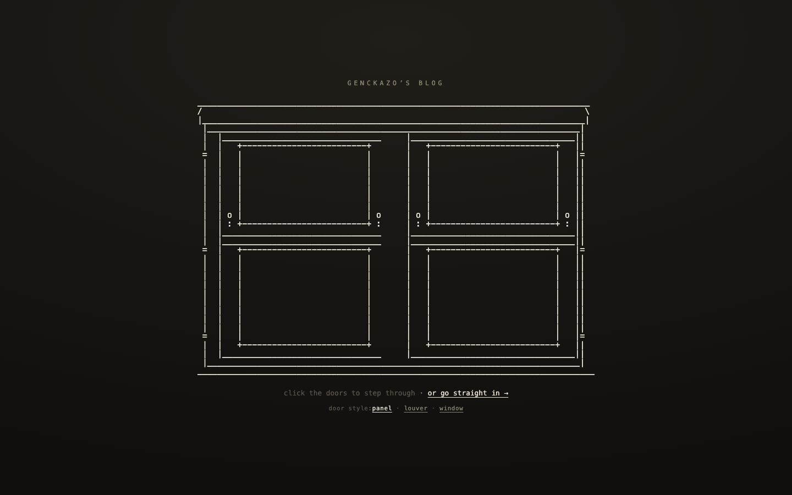
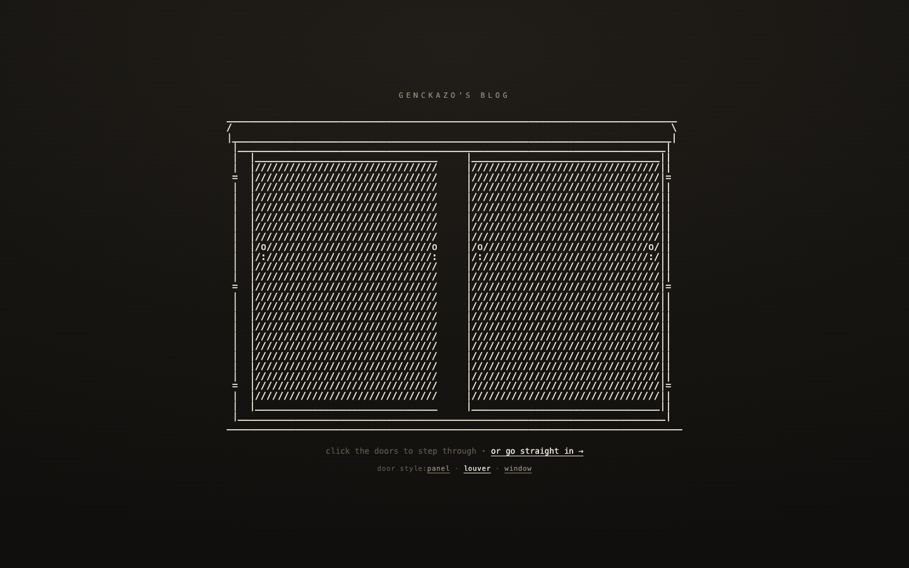
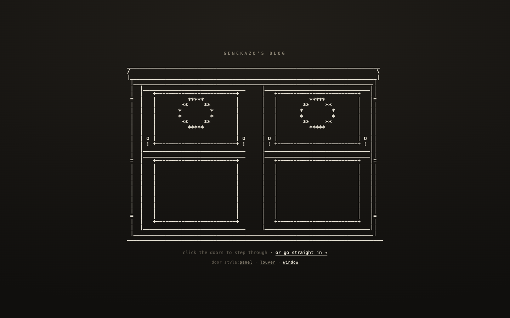
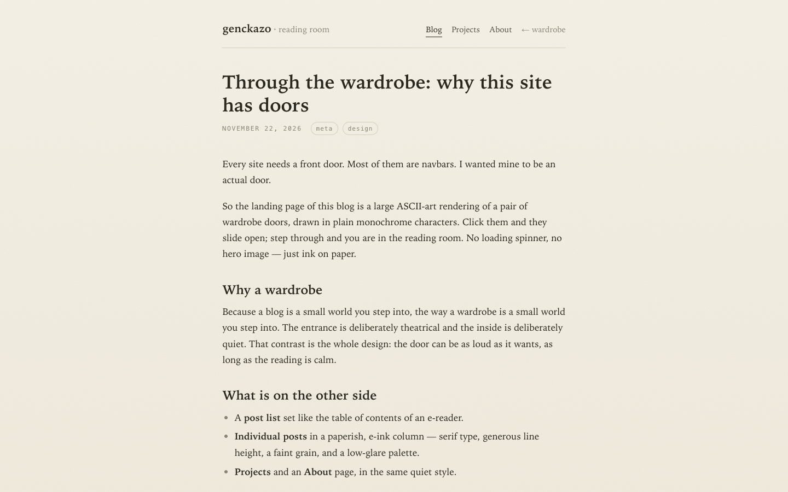
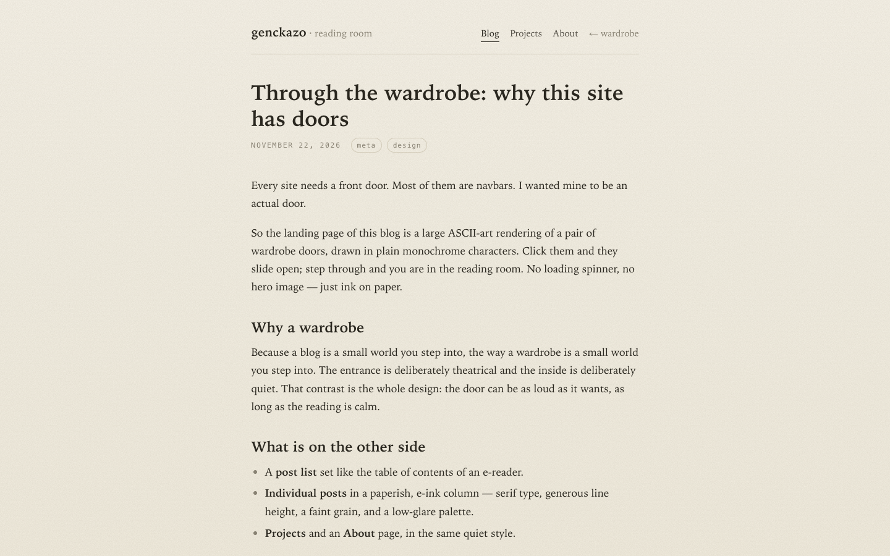
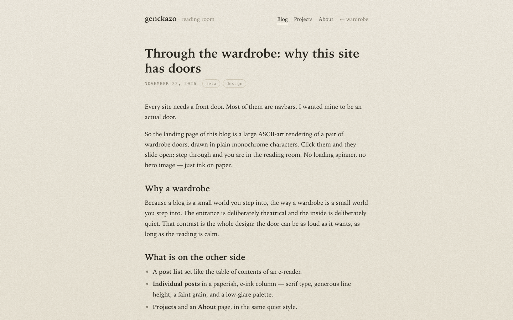

# Design variations (first working version)

The aesthetic is meant to be iterated with the owner. Everything below is
already built in and switchable via URL query params, so each option can be
previewed live on the deployed site — no rebuild needed.

## Entrance: 3 ASCII door renderings

Preview: `https://genckazo.github.io/blog/?door=panel` (default) ·
`?door=louver` · `?door=window`

| Variant | Screenshot | Notes |
|---|---|---|
| **panel** (default) |  | Classic raised-panel double doors with knobs + keyholes |
| **louver** |  | Slatted/louvered doors — busier texture |
| **window** |  | Raised panels with a small round porthole window |

All variants are pure-ASCII, monochrome (warm charcoal background, paper-ink
art), 80×32 characters, and scale with viewport width (`ch`-based sizing).
Clicking the doors slides them open to reveal the reading room, then enters
the blog (see `screenshots/04-doors-opening.png` mid-animation).

To change the default door: reorder `DOOR_ORDER` in `src/data/doors.ts`
(the first entry is the default; `?door=` overrides it).

## Reading pages: 3 paper-grain intensities

Preview: any post with `?texture=subtle` · `?texture=standard` (default) ·
`?texture=strong`

| Intensity | Screenshot | Notes |
|---|---|---|
| subtle |  | `--noise: 0.16`, almost flat paper |
| standard (default) |  | `--noise: 0.38`, faint e-ink grain |
| strong |  | `--noise: 0.62`, clearly textured |

The grain is an inline SVG `feTurbulence` overlay (`mix-blend-mode: multiply`)
over a warm paper gradient — no image assets. To change the default, edit
`--noise` in `src/styles/global.css`.

## Other shipped views

- Blog list (desktop): `screenshots/05-blog-list.png` · mobile: `screenshots/13-list-mobile.png`
- Post page (desktop): `screenshots/06-post-desktop.png` · mobile: `screenshots/10-post-mobile.png`
- Entrance mobile: `screenshots/09-entrance-mobile.png`
- Projects / About: `screenshots/11-projects-desktop.png`, `screenshots/12-about-desktop.png`

## Ideas to try next (not built)

- A fourth door variant: arched top, or a wreath/carving on the upper panel.
- Entrance on paper background instead of charcoal (invert the palette).
- Slight sepia ink (`#3a3226`) instead of near-black for softer contrast.
- A "lamp glow" radial highlight behind the doors when they open.
