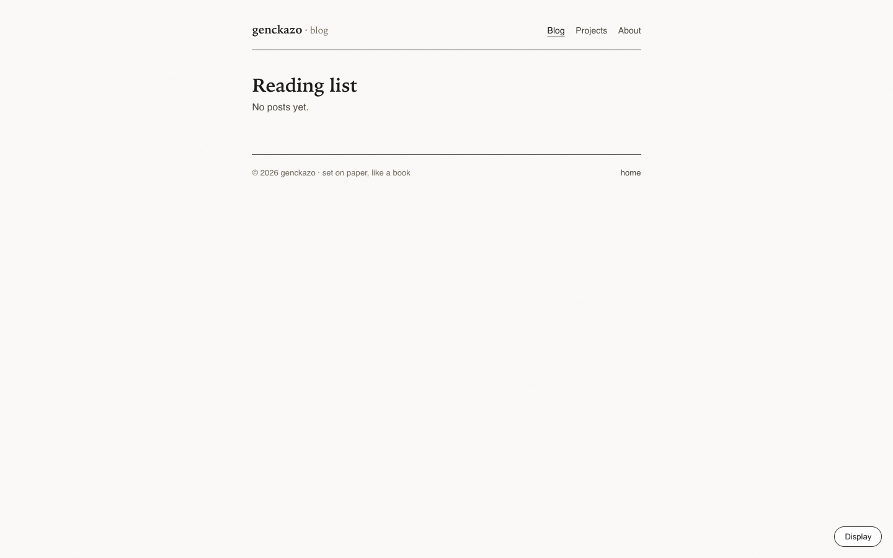
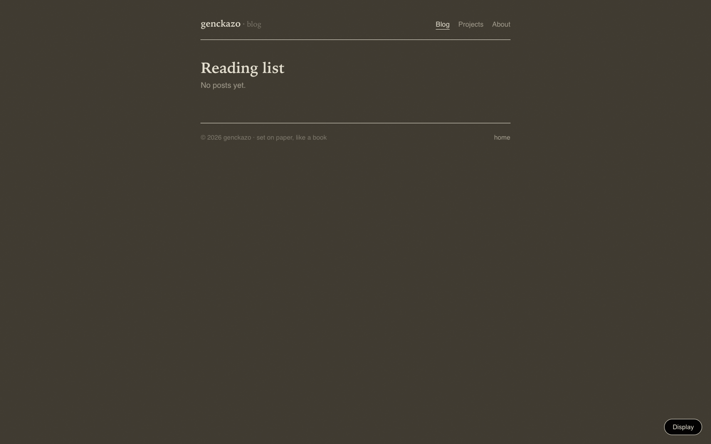
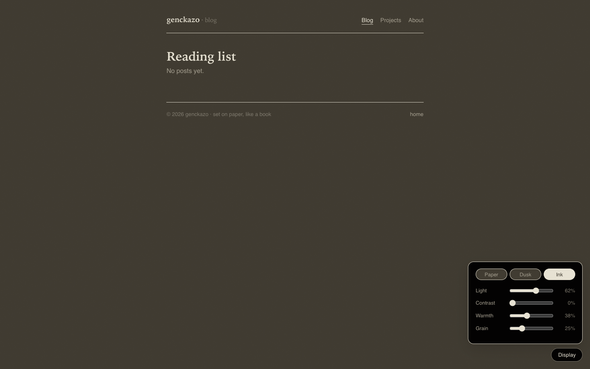

# Design variations

The look is driven entirely by CSS custom properties in `:root`
(`src/styles/global.css`) and can be tuned live with the **Display** panel
(floating button, bottom right) on every page. Settings persist in
`localStorage`; `?texture=subtle|standard|strong` overrides the grain once.

## Display themes (chips in the Display panel)

| Theme | Screenshot | Notes |
|---|---|---|
| **Paper** (default) |  | warm off-white `#f4f1ea`, near-black ink |
| **Dusk** |  | muted warm gray, dark ink — evening reading |
| **Ink** |  | near-black paper, off-white ink — e-ink night mode |

The Display panel itself (chips + Light / Contrast / Warmth / Grain sliders):

## Grain intensity (`?texture=` on any page)

| Level | `--noise` |
|---|---|
| subtle | 16% slider |
| standard (default) | 38% slider |
| strong | 62% slider |

## Pages

- Landing (desktop / mobile): `screenshots/01-landing-desktop.png`, `screenshots/02-landing-mobile.png`
- Reading list (desktop / mobile): `screenshots/03-list-desktop.png`, `screenshots/07-list-mobile.png`
- Projects / About: `screenshots/08-projects.png`, `screenshots/09-about.png`

## Tweak points for the owner

- All colors: `:root` in `src/styles/global.css` (also settable live via the
  Display panel, which writes the same custom properties).
- Themes: the `THEMES` map in the inline script in `src/layouts/Layout.astro`
  (and the copy in `src/pages/index.astro`).
- Grain: `body::after` overlay in `global.css`; `--noise` custom property.
- Typography scale: `.prose`, `.page-title` in `global.css`.
