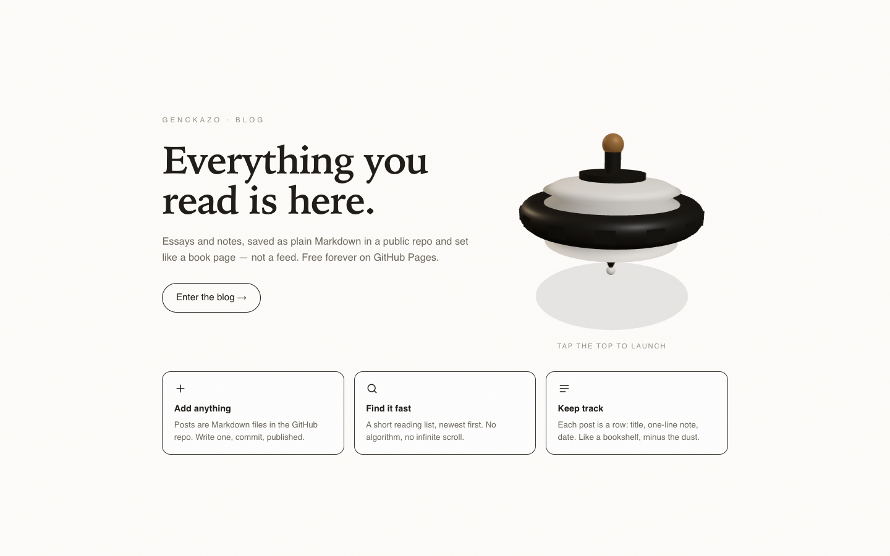
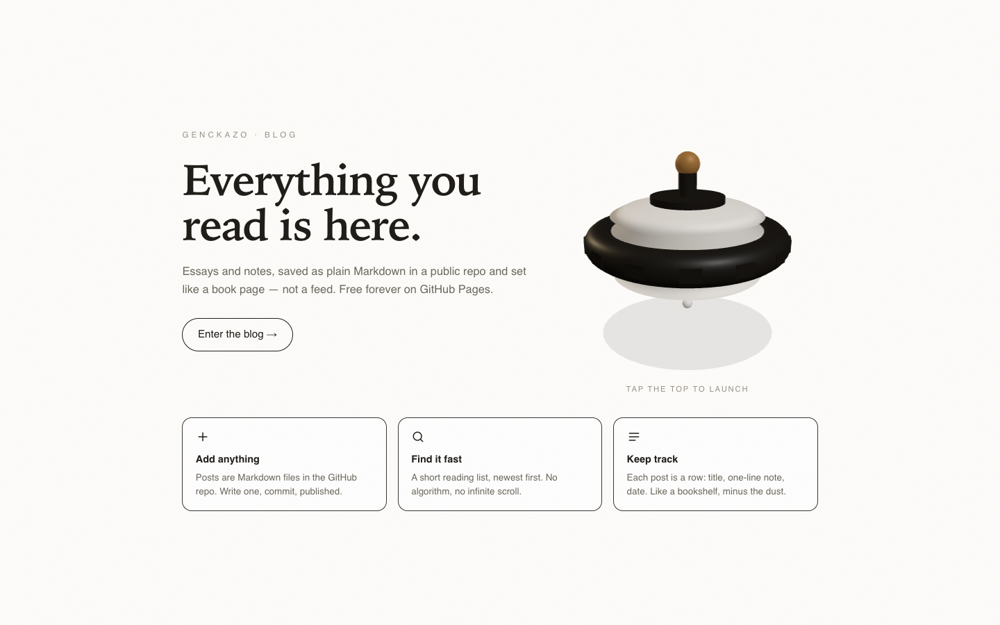
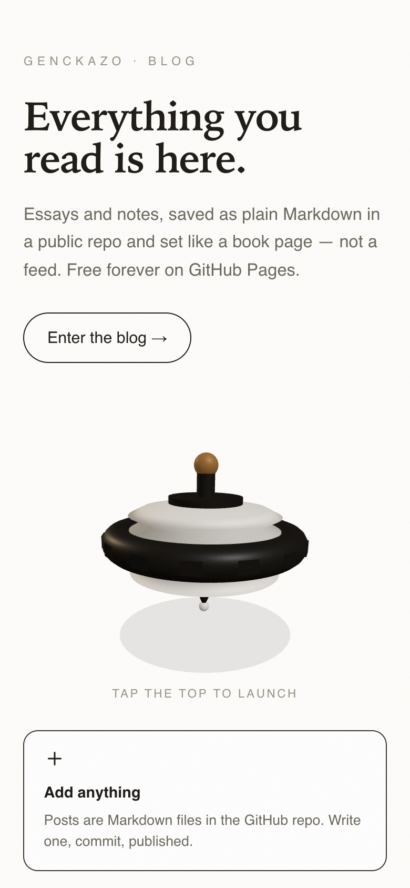
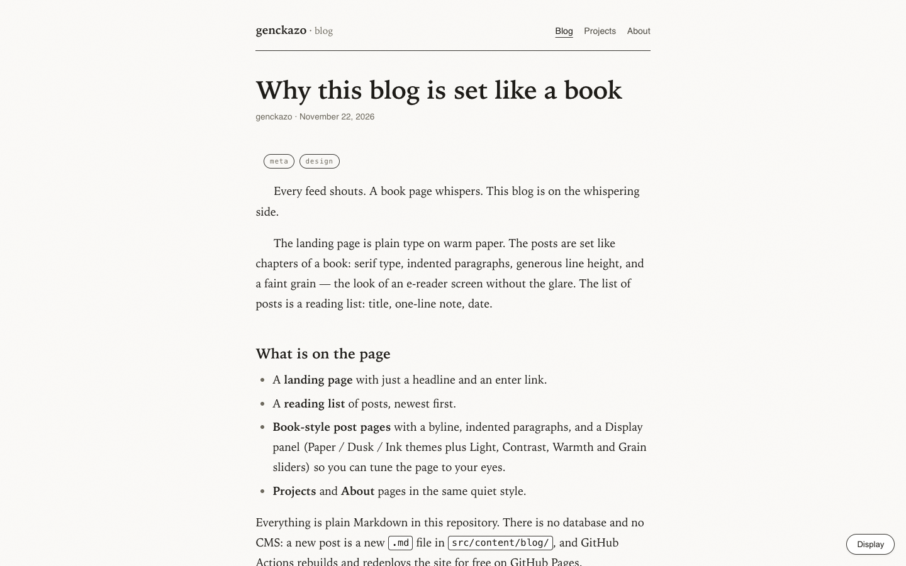
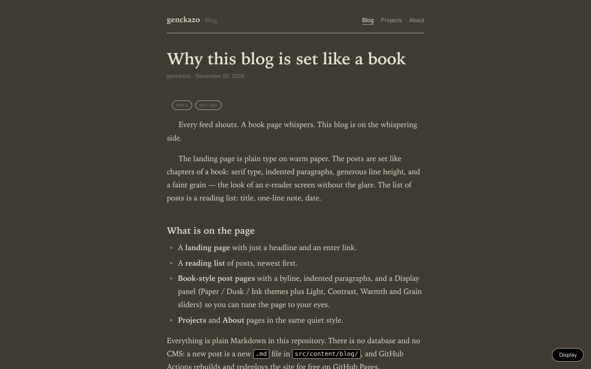
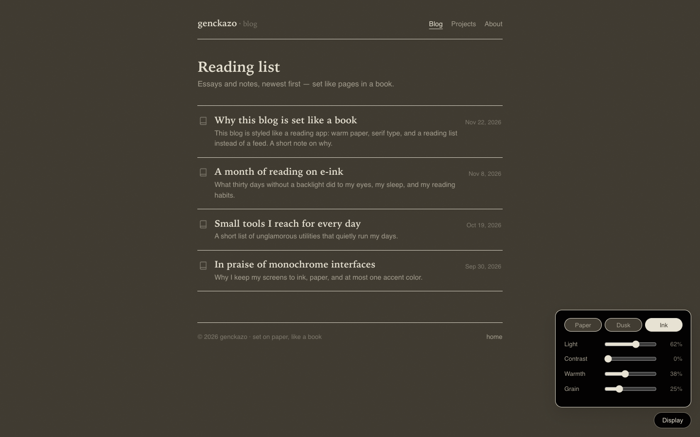
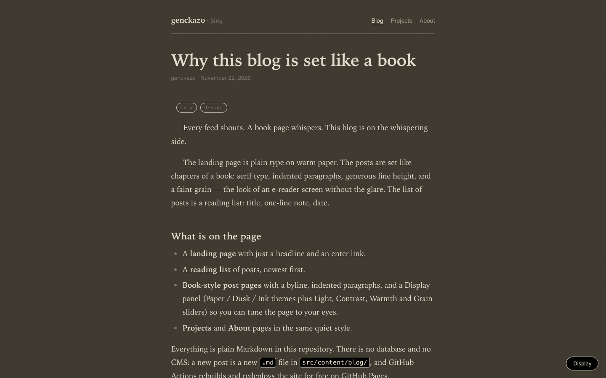

# Design variations
## Landing: procedural 3D battle-top

The landing page shows an original, fully procedural Three.js spinning top beside the
headline (stacked below on phones). Wide attack ring (torus + teeth), ridged energy
layer (lathe), cone tip — no copied models/logos/assets. Palette is read from the
page's CSS custom properties, so it follows the active theme: ink-on-paper with one
muted amber accent. It spins continuously with a slight wobble; click/tap/Enter
launches it (spin ramps up, wobbles, settles). Three.js is an npm dependency loaded as
a lazy chunk via dynamic `import()` only when the page is idle; rendering pauses when
the tab is hidden or the top is off-screen (IntersectionObserver), respects
`prefers-reduced-motion`, and caps `devicePixelRatio` at 2.

| View | Screenshot |
|---|---|
| Landing with top, desktop 1440×900 |  |
| Mid-launch (clicked) |  |
| Landing with top, mobile 390×844 |  |

The look is driven entirely by CSS custom properties in `:root`
(`src/styles/global.css`) and can be tuned live with the **Display** panel
(floating button, bottom right) on every reading page. Settings persist in
`localStorage`; `?texture=subtle|standard|strong` overrides the grain once.

## Display themes (chips in the Display panel)

| Theme | Screenshot | Notes |
|---|---|---|
| **Paper** (default) |  | warm off-white `#f4f1ea`, near-black ink |
| **Dusk** |  | muted warm gray, dark ink — evening reading |
| **Ink** |  | near-black paper, off-white ink — e-ink night mode |

The Display panel itself, exactly as shipped (chips + Light 62% / Contrast 0% /
Warmth 38% / Grain 25% sliders):

## Grain intensity (`?texture=` on any page)

| Level | Screenshot | `--noise` |
|---|---|---|
| subtle | — | 16% slider |
| standard (default) |  | 38% slider |
| strong |  | 62% slider |

## Pages

- Landing (desktop): `screenshots/01-landing-desktop.png` · mobile: `screenshots/02-landing-mobile.png`
- Reading list (desktop): `screenshots/03-list-desktop.png` · mobile: `screenshots/08-list-mobile.png`
- Post page (desktop): `screenshots/04-post-paper-desktop.png` · mobile: `screenshots/07-post-mobile.png`
- Projects / About: `screenshots/11-projects-desktop.png`, `screenshots/12-about-desktop.png`

## Tweak points for the owner

- All colors: `:root` in `src/styles/global.css` (also settable live via the
  Display panel, which writes the same custom properties).
- Themes: the `THEMES` map in the inline script in `src/layouts/Layout.astro`
  (and the copy in `src/pages/index.astro`).
- Grain: `body::after` overlay in `global.css`; `--noise` custom property.
- Typography scale: `.prose`, `.page-title`, `h1.display` in `global.css` /
  `index.astro`.
